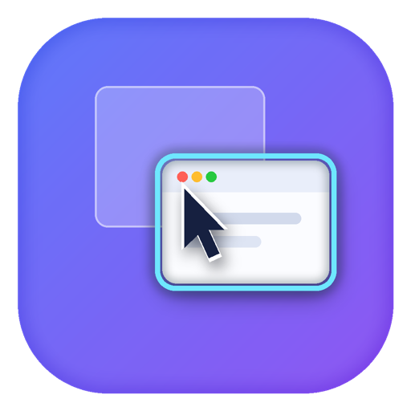

<div align="center">
  
  <h1>HoverFocus</h1>
  <p>鼠标悬停到窗口，键盘焦点就切过去 —— 不用点击。</p>
</div>

macOS 菜单栏小工具。中文界面，纯 Swift，无第三方依赖。

**官网 → [djjjs22.github.io/HoverFocus](https://djjjs22.github.io/HoverFocus/)**

## 它解决什么

macOS 上键盘输入只会进当前前台 App。想在旁边的窗口里打字，得先点它一下—— 而这一下点击可能顺带把窗口顶上来，把你的布局搅乱。

HoverFocus 让鼠标停在哪个窗口上，键盘焦点就切到那个窗口。**默认不改变窗口叠放顺序**。

## 安装

下载 dmg，双击挂载，把 `HoverFocus.app` 拖进「应用程序」。

**不需要授予任何权限，装完即用。**

> dmg 用自签证书签名（不是 Apple Developer ID）。首次打开若提示「无法验证开发者」，
> 右键点 app → 打开 → 再确认一次。这是自签分发的固有限制。

<details>
<summary>或者自己构建</summary>

```bash
git clone https://github.com/djjjs22/HoverFocus.git
cd HoverFocus && make install
```

`make install` 会依次：创建自签证书 → 构建 → 停掉旧实例 → 装到 `/Applications` → 启动。
</details>

## 核心特性

**鼠标停在哪，键盘就在哪。** 不需要点击，也不需要窗口先跳到最前面。

**不打断你的窗口布局。** 切焦点走 SkyLight 的 `_SLPSSetFrontProcessWithOptions`，
只改前台 App 顺序，不动窗口 z 序。你的窗口该压着谁就压着谁。

**默认零权限。** 每 16ms 读一次光标位置，纯读取系统状态，装完直接用。
授予辅助功能权限是可选的精度增强（解决窗口重叠、圆角、透明区域的命中判断），不是使用前提。

**dwell 延时 + 动作后冷却。** 指针要在同一个窗口上停够时间才动手，
中途移开就重新计时；动作之后还有一段冷却期防抖。鼠标只是路过不会抢焦点。
两者都可调，冷暖手感自己定。

**四道守卫，该不动就不动。**

| 守卫 | 什么时候挡住 |
|---|---|
| 修饰键 | 按住 ⌘⌥⌃⇧ 时 —— 你在用快捷键 |
| 拖拽 | 拖窗口、拖选文字时 —— 拖拽中改叠放会直接取消拖拽 |
| 全屏 | 前台 App 全屏时 —— 看视频、演示、共享屏幕时不该乱跳 |
| 文本编辑 | Finder 重命名、表格改单元格时 —— 失焦会取消编辑，白输入 |

修饰键里 Caps Lock 和 fn 不算意图修饰键，按住它们切窗口是正常操作。
文本编辑守卫只挡单行输入框，多行文本区故意不挡 —— 否则在聊天框里打字时永远切不了窗口。

**⌃⌥H 一键暂停/恢复。** 录屏讲解、多窗口对照录入、窗口化游戏时按一下暂停，
菜单栏图标变灰；再按一次恢复。用鼠标去关一个「鼠标一动就出问题」的功能本来就自相矛盾。

**排除名单。** 不想被抢焦点的 App 加进名单，重启后依然有效。
鼠标停在目标 App 上 → 点菜单栏 → 一键排除。按 Bundle ID 匹配，不是靠显示名。

**诊断面板说人话。** 菜单里能直接看到每个忽略原因的累计次数
（`正在拖拽` 218 次 / `按住修饰键` 11 次 / `冷却中` 9 次……），
不用猜、不用翻日志。「为什么没生效」当场就有答案。

## 几个设计决定

**焦点和叠放是两件事。** 悬停切焦点很容易被顺手做成「顺便把窗口顶上来」，
但这两件事本该分开。HoverFocus 只改前台 App 顺序，窗口 z 序一动不动。

**做不到的事不装。** 「不置顶」依赖私有符号，符号不存在时会退回公开 API，
那时窗口会被顶上来 —— 程序会在诊断里明确报「置顶了 = 是」，不假装成功。

**已知边界说在明面上。** 未授权时窗口重叠、圆角、阴影可能判错；
「低延迟」模式是否真比轮询更跟手没做过端到端对比，所以默认仍用轮询；
极短促的拖拽理论上可能漏判。这些都没藏着。

## 开发

```bash
make app     # 构建 build/HoverFocus.app
make test    # 跑测试
make dmg     # 打包 dist/HoverFocus-0.1.1.dmg
make dmg-verify  # 挂载 dmg 实测：结构 / 签名 / 拖拽后能不能跑
```

不用 SwiftPM，一条 `swiftc` 命令把全部源文件编成同一个模块，测试是手写运行器。

## 目录

```
Sources/HoverFocus/       菜单栏 App：UI、设置窗口、权限引导、自检
Sources/HoverFocusCore/   判定引擎、窗口探测、事件源、激活策略
Scripts/                  build / install / make-dmg / test
```

## 许可

[MIT](LICENSE)